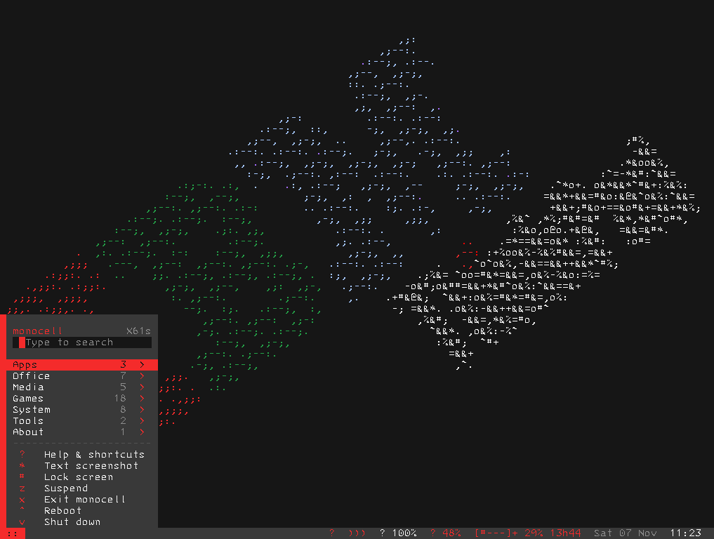

# TRD — Text Remote Desktop für Monocell

TRD zeigt den Bildschirm eines [Monocell](../monocell)-Desktops in einem Fenster auf
einem anderen Rechner — als **Text**, nicht als Bild. Die Zellmatrix wird über einen
SSH-Tunnel übertragen und mit der echten Konsolenschrift gezeichnet, dazu kommt der
**Ton** des Zielgeräts. Gedacht für den Fall, dass ein alter Rechner (hier ein
ThinkPad X61s) als textbasierter Arbeitsplatz läuft und man von der Workstation
aus damit arbeiten will.



## Wie es funktioniert

Auf dem Ziel läuft Monocell und damit der TRD-Server (`monocell/remote.py`). Er
lauscht nur auf `127.0.0.1` mit einem Zufallstoken und schreibt Port und Token in
eine Metadatei (`~/.cache/monocell/trd.json`, Rechte 0600). Der Client liest diese
Datei über SSH, baut einen SSH-Tunnel auf und spricht darüber ein kleines
Binärprotokoll:

| Richtung | Inhalt |
|---|---|
| Server → Client | Zellmatrix als Diff (nur geänderte Zellen: x/y, Glyphenindex, fg/bg), dazu die PSF-Konsolenschrift, Metadaten, Cursor, Status, Ton (PCM) |
| Client → Server | Tastatur, Maus (Klick, Ziehen, Rad), Einfügen, Snapshot-Anforderung |

Die Glyphen werden beim Client aus der **PSF-Datei des Ziels** gerendert, deshalb
sieht das Fenster genauso aus wie der echte Bildschirm (9×16 beim IBM-3270-Font,
6×12 bei Terminus usw.). Der Zoom skaliert nur das Fenster, nie das Raster.

Der Ton wird serverseitig vom Monitor der Standard-Senke abgegriffen (`parec`),
in 10-ms-Stücken getaktet und im selben Tunnel übertragen; der Client puffert
400 ms. Die Aufnahme schreibt die PCM-Daten samplegenau mit und muxxt sie später
mit dem Video (H.264/AAC).

**Grafikmodus:** Video, Bilder, Maps und der Browser-Grafikmodus zeichnen in den
Framebuffer; TRD überträgt nur Text und zeigt dort einen Hinweis. Der Ton läuft
weiter.

## Voraussetzungen

- Ziel: Monocell (der TRD-Server steckt darin), SSH-Zugang, `parec` für Ton
- Client: Python 3.10+, PyQt6, numpy; `pacat`, `pw-play` oder `aplay` für Ton;
  `ffmpeg` für Aufnahmen; SSH mit Schlüssel oder Passwort

## Installation

```sh
./install.sh
```

Legt `~/.local/bin/trd`, den Menüeintrag und die Icons unter
`~/.local/share/icons/hicolor/` an (erzeugt von `make_icon.py`). Start über das
Startmenü, die Taskleiste oder `trd`.

## Bedienung

Beim Start fragt TRD nach Gerät und SSH-Login (Schlüssel oder Passwort); beides
wird gemerkt. Danach ist das Fenster die Fernsteuerung:

| Taste | Wirkung |
|---|---|
| `F11` | Vollbild (lokal) |
| `Ctrl+F11` | F11 an das Ziel schicken |
| `Ctrl+Plus` / `Ctrl+Minus` / `Ctrl+0` | Zoom |
| `Ctrl+M` | Ton an/aus |
| `Ctrl+Shift+V` | Einfügen (Workstation → Ziel) |
| `Ctrl+Shift+Q` | beenden |

Alles andere geht an das Ziel. Ein Screenshot (`Aufnahme → Screenshot speichern`)
schreibt eine `.md`-Textdatei und eine farbige `.html`-Fassung; die Videoaufnahme
schreibt `.mkv` mit Ton.

## Grenzen

- Nur **ein Client** gleichzeitig (der Server lehnt weitere Verbindungen ab).
- Grafikmodus wird nicht übertragen (siehe oben).
- Der Ton braucht eine laufende SSH-Verbindung; bricht sie ab, endet die Sitzung.

## Lizenz

MIT, siehe [LICENSE](LICENSE). © 2026 Alexander Riedel.
